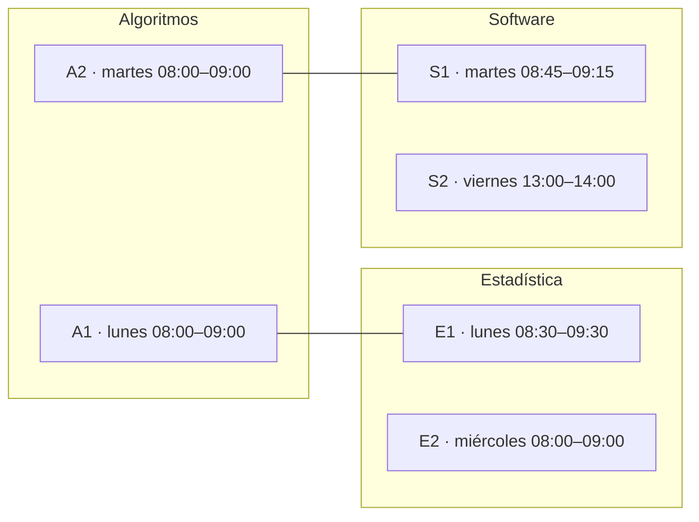

# Nivel 0: restricciones duras

## Objetivo

Generar asignaciones que el estudiante pueda elegir, seleccionando una sección
por curso. Cada grupo elegido debe tener al menos un cupo disponible y sus
sesiones no pueden cruzarse el mismo día con las demás.

Una sesión se representa con un día canónico y minutos desde la medianoche. Los
intervalos son semiabiertos: una sesión que termina a las 10:00 puede ir seguida
de otra que empieza a las 10:00.

## Algoritmo y caso base

`generateLevelZeroSchedules` en `src/domain/scheduling/level-zero.ts` modela
cada sección como un vértice. Construye una arista entre secciones de cursos
distintos cuando alguna sesión de una se cruza con una sesión de la otra. Cada
curso es una variable y sus secciones forman el dominio de valores posibles; una
solución elige exactamente una sección por curso y no elige dos vértices unidos
por una arista.

Una sección cuyas propias sesiones se cruzan se excluye antes de construir el
grafo. La capa de aplicación adapta el JSON del proyecto (`catalogo.grupos` y
`estudiante.materias`) a este modelo. Comprueba que `cuposDisponibles` sea un
entero no negativo y pasa al grafo solo los grupos con cupos positivos.
Acepta días en español o numéricos y
horas en minutos o como texto `HH:mm`; el dominio recibe días canónicos y
minutos enteros.

## Grafo de conflictos

Cada nodo representa una sección candidata. Una arista une dos secciones de
cursos distintos cuando sus sesiones se traslapan. Un horario válido escoge un
nodo por curso sin incluir ambos extremos de ninguna arista.

En este ejemplo, `A1` no puede combinarse con `E1`, y `A2` no puede
combinarse con `S1`. Las demás parejas no tienen una arista entre sí. Las
heurísticas ordenan qué curso y sección se prueban primero; el grafo determina
qué combinaciones se descartan.

La búsqueda por profundidad mantiene una asignación parcial y revisa los
dominios restantes después de cada elección. Aplica estas heurísticas:

1. **MRV:** elige primero el curso con menos secciones todavía compatibles.
2. **Grado:** si hay empate, prioriza el curso con más conflictos posibles.
3. **LCV:** prueba primero la sección que elimina menos opciones de los otros
   cursos sin asignar.

Si una elección deja un curso sin opciones, se poda esa rama porque agregar más
cursos no puede repararla.

El caso base ocurre cuando se eligió una sección para cada curso. En ese punto
se guarda una copia de la asignación. Si un curso no tiene secciones compatibles,
esa rama termina sin producir horario. La búsqueda acepta un máximo de
resultados para evitar devolver una cantidad ilimitada; informa `truncated` solo
cuando encuentra un horario adicional después de alcanzar el límite.

La subrutina `findMeetingConflict` ordena las sesiones por día y hora de inicio.
En cada día conserva la sesión que termina más tarde. Si la siguiente sesión
empieza antes de ese fin, devuelve el par que demuestra el cruce. La elección
del fin más tardío también detecta cruces cuando una sesión está contenida en
otra.

## Por qué este algoritmo

El grafo convierte la regla dura en una incompatibilidad entre opciones. La
búsqueda con retroceso conserva la elección de una sección por curso, y el
chequeo hacia adelante elimina pronto ramas que ya no pueden completarse. MRV,
grado y LCV priorizan las decisiones más restrictivas y las opciones que
conservan más alternativas. La heurística cambia el orden de búsqueda, no las
soluciones permitidas.

En este nivel se elige entre secciones con horarios ya definidos, así que el
grafo representa incompatibilidades entre secciones. Asignar colores para
decidir franjas horarias sería útil cuando las sesiones todavía puedan
ubicarse en diferentes bloques; ese dato aún no forma parte de la entrada.

## Complejidad

Sean `V` el número total de secciones, `M` el máximo de sesiones por sección y
`sᵢ` el número de secciones del curso `i`. La construcción del grafo compara
secciones de pares de cursos y cuesta `O(V² M log M)` en esta implementación;
el grafo usa `O(V + E)` espacio, donde `E` es la cantidad de incompatibilidades.
La búsqueda puede visitar hasta `∏ sᵢ` asignaciones en el peor caso, más el
costo de calcular dominios y ordenar opciones en cada paso. Las heurísticas
pueden reducir las ramas exploradas, pero no cambian la cota exponencial del
peor caso. La memoria de salida depende del límite de horarios y de cuántas
secciones tenga cada horario.

## Verificación con datos

`compose.yaml` levanta PostgreSQL y carga tres escenarios al inicializar el
volumen: opciones sin cruces (4 horarios), conflicto inevitable (0 horarios) y
cruce anidado con sesiones contiguas (6 horarios). La prueba consulta esos
registros y compara el resultado del generador con el conteo esperado; también
comprueba que ningún horario devuelto tenga traslapes. La ruta de Next
`/api/generate` adapta el JSON real y llama al mismo generador. Las pruebas del
JSON también cubren grupos llenos, cupos inválidos y el caso en que una materia
se queda sin opciones.

Ejecuta `pnpm test:level-zero` con Docker Desktop disponible. El servicio y los
datos quedan en el volumen local `postgres_data`.

## Persistencia local y participantes

Las rutas `/api/users` y `/api/schedules` consultan PostgreSQL en el servidor.
Antes de guardar, el servidor reconstruye las sesiones desde el catálogo
adjunto y comprueba que haya un grupo con cupo por materia y que no haya cruces.
Los cupos corresponden al momento del que proviene ese catálogo.
Una transacción inserta el resultado JSON, el JSON de origen, el
nivel y el propietario junto con los participantes seleccionados. Los usuarios
de esta etapa son datos de desarrollo; el selector no ofrece autenticación y no
debe exponerse como tal. Supabase Auth queda para una etapa posterior.
