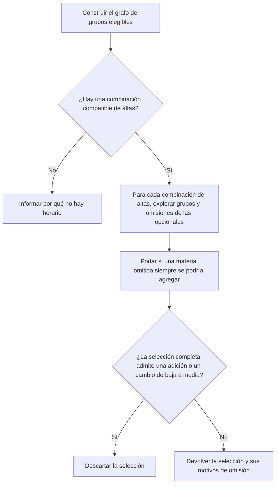
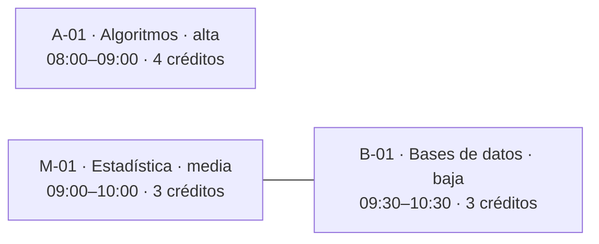

# Prioridad de las materias en el nivel 1

## Criterios

1. Cada materia alta tiene exactamente un grupo elegido.
2. Cada materia media o baja omitida carece de un grupo con cupo que pueda
   añadirse a la selección actual sin cruzar sesiones ni superar el máximo de
   créditos del estudiante.
3. Para cada materia media omitida, también se prueba sustituir una materia
   baja incluida. Se retira únicamente el grupo de esa baja y se conserva el
   resto de la selección. Si algún grupo de la media cabe así, el horario se
   descarta.

El contrato usa `alta`, `media` y `baja` en `estudiante.materias[].prioridad`.
Los valores numéricos 1, 2 y 3 del formato anterior siguen admitidos. Los
créditos de cada materia se toman de `catalogo.materias[].creditos`. Omitir
`estudiante.creditosMax` permite cualquier total al intentar una adición o
sustitución. La evaluación del total del horario frente a `creditosMin` y
`creditosMax` corresponde al nivel 2.

## Búsqueda y caso base

`generateLevelOneSchedules` usa el grafo de incompatibilidades del nivel 0.
Cada vértice es un grupo con cupo cuyas sesiones internas son compatibles.
Dos vértices de materias distintas tienen una arista cuando se cruzan. Primero
se exploran las materias altas, empezando por las que tienen menos grupos.
Para cada materia opcional se exploran sus grupos compatibles y la rama que
la omite.

Una rama de omisión se puede podar si algún grupo de esa materia siempre
podría agregarse a cualquier hoja de la rama. Esto se comprueba cuando el
grupo es compatible con los seleccionados y con todos los grupos restantes,
y todavía cabe en créditos si se seleccionan todas las materias restantes.

En el caso base ya se decidió qué grupo elegir o qué materia omitir. Para
cada omisión, se compara cada grupo elegible con los ya elegidos. Si cabe en
créditos y no tiene conflictos, existe una adición. Para una media omitida
también se comprueba si los conflictos desaparecen al retirar un único grupo
bajo y si el total resultante cabe en créditos. Se devuelve la hoja solo si
supera todas las comprobaciones. La búsqueda sigue hasta encontrar un
horario válido adicional al límite de salida para determinar `truncated`.

### Flujo de la búsqueda

### Ejemplo de sustitución

El [caso de prueba de prioridades](../../tests/selenium/fixtures/prioridades.json)
usa un máximo de 7 créditos. Cada nodo representa un grupo y la arista marca
el único cruce del lunes, entre las 09:30 y las 10:00.

| Selección | Créditos | Resultado del nivel 1 |
| --- | ---: | --- |
| A-01 | 4 | Se puede añadir M-01 o B-01. |
| A-01 y B-01 | 7 | Se puede sustituir B-01 por M-01. |
| A-01 y M-01 | 7 | Se devuelve el horario. Añadir B-01 causaría un cruce y llevaría el total a 10 créditos. |

## Justificación

Cada asignación de nivel 0 que incluye todas las altas tiene un camino en
el árbol de grupos y omisiones. El grafo descarta las ramas que ya tienen
un cruce, y la poda de omisiones descarta únicamente ramas que admiten una
adición en todas sus hojas. El caso base comprueba exactamente las
adiciones y sustituciones individuales del enunciado. El algoritmo puede
devolver horarios maximales con distinta cantidad de materias.

Si una materia alta carece de grupos elegibles se indica cuál y por qué.
Si todas tienen algún grupo pero ningún conjunto es compatible, se indican
las altas implicadas. A partir de cualquier selección compatible de altas
se puede alcanzar una hoja válida con una secuencia finita de mejoras.
Cada adición aumenta el número de materias incluidas y cada sustitución
mantiene ese número y aumenta el número de materias medias incluidas.

## Complejidad

Sean `n` las materias solicitadas, `gᵢ` los grupos elegibles de cada materia,
`V` el total de esos grupos, `E` las aristas y `M` el máximo de sesiones por
grupo. Construir el grafo cuesta `O(V² M log(2M))` tiempo y `O(V + E)`
espacio. El árbol tiene hasta `∏ gᵢ` hojas para las altas, multiplicadas
por `∏ (gᵢ + 1)` para las opcionales. El costo por hoja es `O(n + Vn)`
para comprobar todos los grupos omitidos contra las selecciones.
Las podas y el límite de salida reducen el trabajo en instancias concretas.

## Aplicación y pruebas

`POST /api/generate` evalúa el nivel 1 con `level: 1`. La petición admite
`level: 0` para ejecutar el nivel anterior. En el nivel 1, cada opción
devuelve sus créditos totales, las materias omitidas y sus razones. La
interfaz muestra estas razones y las conserva en las exportaciones JSON y
TXT.

Al guardar, el servidor vuelve a leer el catálogo y reconstruye la
selección, los créditos y las razones. Aplica las mismas reglas del nivel
1 antes de guardar el nivel, el resultado, el JSON original y los
participantes en PostgreSQL. Los horarios guardados en nivel 0 siguen
disponibles.

`pnpm test:level-one` cubre altas inviables, omisiones por cupo, conflicto o
créditos, adiciones, sustituciones, límites de salida y selecciones
alteradas. También compara el generador con una enumeración independiente
en 160 catálogos reproducibles. Con la aplicación y PostgreSQL activos,
`pnpm test:level-one:api` y `pnpm test:selenium` prueban los puntos de entrada,
la visualización, las exportaciones y el guardado compartido.
