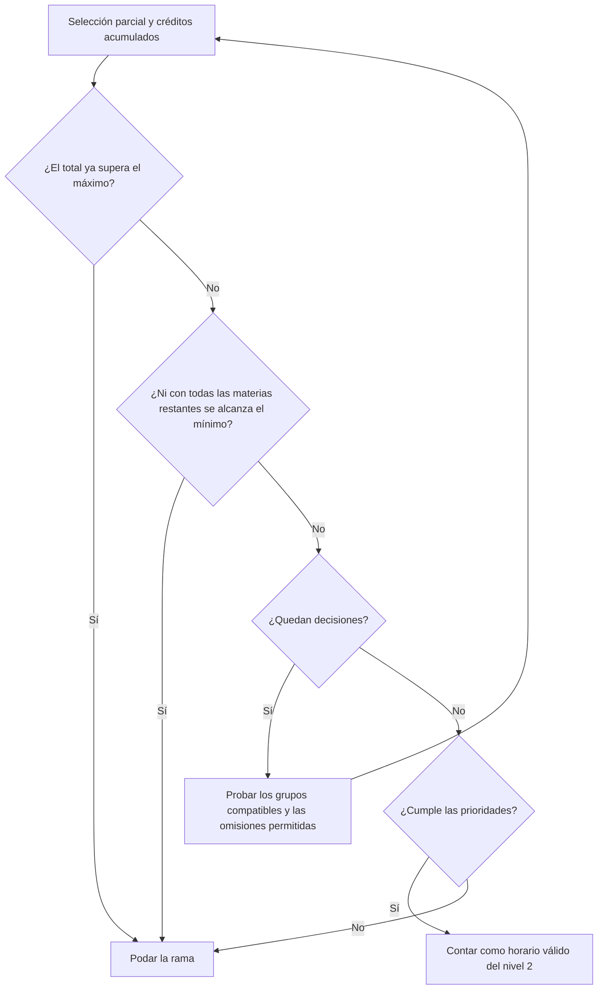

# Rango de créditos en el nivel 2

## Criterio y entrada

El total se obtiene sumando los créditos del catálogo una vez por cada
materia incluida. Un horario de nivel 2 cumple los niveles 0 y 1 y satisface
`creditosMin ≤ total ≤ creditosMax`. Los extremos son inclusivos.

`estudiante.creditosMin` y `estudiante.creditosMax` son opcionales. Si se
declaran, deben ser enteros positivos y el mínimo debe ser menor o igual al
máximo. Si falta el mínimo, se usa 0. Si falta el máximo, el total queda sin
tope. El nivel 1 conserva su regla de usar el máximo para decidir si una
adición o sustitución es viable.

## Búsqueda y caso base

`generateLevelTwoSchedules` usa el mismo árbol de asignaciones del nivel 1.
Al elegir un grupo se añaden los créditos de su materia al total parcial.
Antes de buscar, se calcula para cada posición la suma de los créditos de
las materias restantes con grupos elegibles. Esa suma también cuenta las
materias opcionales, así que da una cota superior válida.

El caso base llega cuando todas las materias tienen una decisión. En ese
punto, una rama que sigue activa está dentro del rango. Se comprueban las
prioridades y se añade el horario válido a la salida. `truncated` se activa
cuando se encuentra otro horario de nivel 2 después del límite de resultados.

## Ejemplo

Con una alta de 4 créditos, una media de 3 y una baja de 2, supón que sus
grupos son compatibles y que el perfil pide exactamente 7 créditos.

| Selección | Total | Resultado |
| --- | ---: | --- |
| Alta y media | 7 | Cumple el rango y agregar la baja superaría el máximo. |
| Alta y baja | 6 | Queda por debajo del mínimo. El nivel 1 también permite sustituir la baja por la media. |
| Alta, media y baja | 9 | Supera el máximo. |

## Justificación y complejidad

Todos los créditos son positivos. Una rama que ya supera el máximo nunca
puede reducir el total al agregar más materias. Si el total más todos los
créditos restantes queda por debajo del mínimo, ningún subconjunto de esas
materias alcanza el mínimo. Por lo tanto, podar ambas ramas conserva todas
las selecciones válidas. En una hoja, la cota de los créditos restantes es
cero y la evaluación comprueba exactamente el intervalo.

El cálculo de las sumas restantes cuesta `O(n)` tiempo y espacio. Las
comparaciones por estado de búsqueda cuestan `O(1)`. Se mantienen las cotas
del [grafo y la búsqueda](nivel-1-prioridades.md) del nivel 1. El peor caso
sigue siendo exponencial y la poda evita recorrer ramas cuyo total queda
fuera del rango.

## Aplicación y pruebas

`POST /api/generate` ejecuta este nivel con `level: 2`. Los niveles
anteriores siguen disponibles con `level: 0` y `level: 1`. La interfaz
muestra los límites declarados y el total de cada resultado. Al guardar,
el servidor reconstruye las materias y el total desde el catálogo y
valida nuevamente el rango. PostgreSQL conserva el nivel y los créditos
en el resultado guardado.

`pnpm test:level-two` cubre límites exactos, campos omitidos, rangos
inválidos, selecciones fuera del rango y truncamiento. También compara
las podas con el filtrado completo en 120 catálogos reproducibles. Con
Next y PostgreSQL en ejecución, `pnpm test:level-two:api` y
`pnpm test:selenium` verifican la API, el ejemplo web, las descargas
y el guardado compartido.
