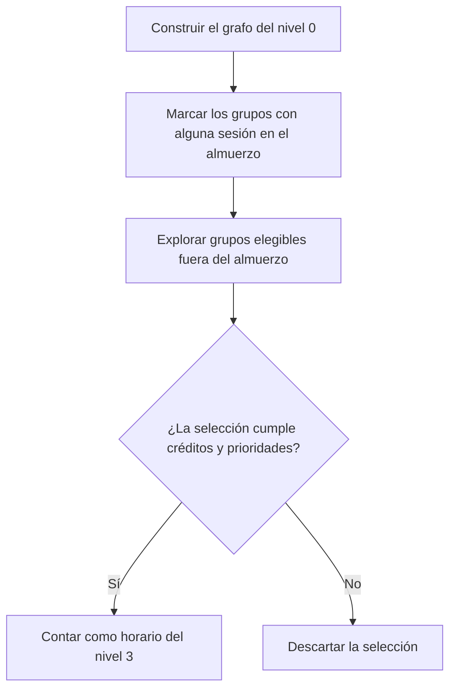

# Ventana de almuerzo en el nivel 3

## Criterio

Cada horario del nivel 3 satisface los niveles 0, 1 y 2 y deja libre la
ventana de 13:00 a 14:00 en todos los días del catálogo. La ventana está
activa para todos los estudiantes.

Las horas se representan como minutos desde medianoche. Para una sesión
`[inicio, fin)`, hay un cruce cuando `inicio < 840` y `fin > 780`. Una
sesión que termina exactamente a las 13:00 o que empieza exactamente a las
14:00 deja libre la ventana.

## Búsqueda y caso base

Después de construir el grafo de incompatibilidades, se revisan las sesiones
de cada grupo elegible. Si alguna cruza el almuerzo, la búsqueda descarta
ese grupo como elección. Si una materia alta queda sin una opción elegible
fuera de la ventana, la búsqueda termina sin horarios.

En el caso base, cada grupo elegido ya deja libre el almuerzo. La búsqueda
evalúa las prioridades de la selección y cuenta el horario únicamente si
cumple todos los criterios. El límite de resultados cuenta solo horarios
válidos del nivel 3.

El grafo completo se conserva para comprobar qué materias podrían añadirse
o sustituirse en el nivel 1. Por ejemplo, si una media omitida todavía
puede añadirse según los criterios del nivel 1, el horario falla ese nivel
aunque el grupo de la media coincida con el almuerzo. La ventana se aplica
a los grupos elegidos en el resultado.

## Ejemplo

El [archivo de ejemplo](../../public/horario-ejemplo.json) ofrece dos
grupos de Ingeniería de software. Elegir el grupo de las 14:00 mantiene
los créditos de la materia y deja libre el almuerzo.

| Grupo y sesión del viernes | Resultado del nivel 3 |
| --- | --- |
| SOF-01, 13:00 a 15:00 | Cruza el almuerzo. |
| SOF-02, 14:00 a 16:00 | Compatible con el almuerzo. |

## Justificación y complejidad

La validez de un grupo respecto de la ventana depende de sus propias
sesiones. Por eso descartar el grupo antes de elegirlo elimina exactamente
las ramas que lo asignarían. Las comprobaciones de los niveles anteriores
siguen vigentes sobre las selecciones restantes. El resultado equivale a
filtrar la salida completa del nivel 2 por la ventana antes de limitar
cuántos horarios se devuelven.

Si hay `V` grupos elegibles y `M` sesiones como máximo por grupo, marcar
los grupos cuesta `O(VM)` tiempo y `O(V)` espacio. Consultar la marca de
un grupo cuesta `O(1)`. La búsqueda conserva la cota de peor caso del
[nivel 2](nivel-2-creditos.md).

## Aplicación y pruebas

`POST /api/generate` usa el nivel 3 por defecto y permite solicitar de forma
explícita los niveles 0, 1 y 2. El calendario marca el espacio protegido.
Al guardar, el servidor reconstruye las sesiones con el catálogo fuente y
comprueba nuevamente la ventana.

`pnpm test:level-three` verifica límites exactos, cruces de un minuto,
grupos con varias sesiones, prioridades y truncamiento. También compara
la búsqueda con el filtrado completo en 120 catálogos reproducibles.
`pnpm test:level-three:api` verifica generación y guardado, y
`pnpm test:selenium` comprueba el calendario y el guardado compartido.
