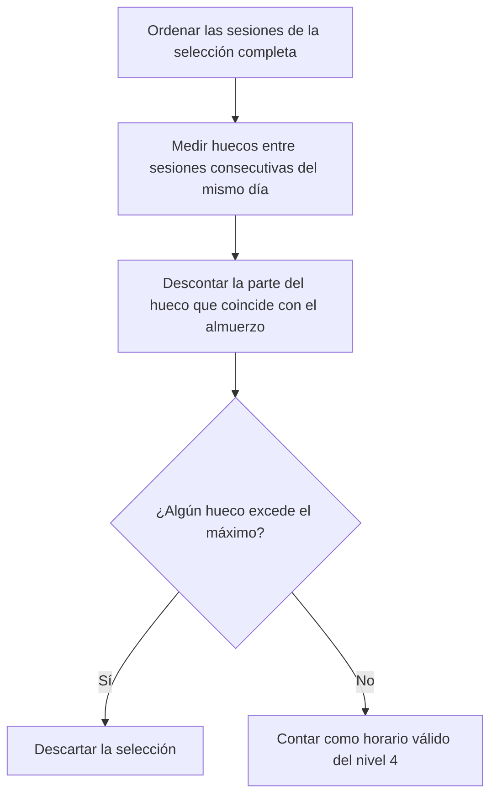

# Huecos entre sesiones en el nivel 4

El perfil puede declarar `estudiante.huecos.tipo` como `indiferente`,
`ninguno` o `cortos`. Si se omite, se usa `indiferente`. El modo `ninguno`
admite cero minutos libres y `cortos` exige un `maxMinutos` entero no
negativo. El máximo es inclusivo.

## Búsqueda y caso base

En cada selección completa de nivel 3 se ordenan las sesiones por día y
hora de inicio. Se compara cada par consecutivo del mismo día. Del tiempo
entre el fin de la primera sesión y el inicio de la segunda se descuentan
los minutos que coinciden con la ventana de almuerzo de 13:00 a 14:00.

En el caso base, si el modo es `indiferente`, la selección pasa directamente.
Con una restricción activa se acepta cuando todos los huecos cumplen el
máximo. Una asignación parcial puede adquirir una sesión que llene un hueco,
por lo que la comprobación se hace al completar el horario, antes de contar
el resultado para el límite de salida.

## Ejemplo

En el [catálogo de prueba](../../tests/selenium/fixtures/huecos.json), una
clase acaba a las 13:00. El grupo que empieza a las 14:00 deja cero minutos
libres al descontar el almuerzo. El grupo que empieza a las 14:30 deja
30 minutos libres y se acepta desde un máximo de 30.

## Justificación y complejidad

Al ordenar las sesiones, cada hueco del mismo día aparece exactamente una vez
entre dos sesiones consecutivas. La longitud de la intersección con el
almuerzo coincide con los minutos que deben descontarse. Con `S` sesiones,
la comprobación de una selección cuesta `O(S log S)` tiempo y `O(S)` espacio
para la copia ordenada. Se conserva la búsqueda de los niveles anteriores.

## Aplicación y pruebas

`POST /api/generate` ejecuta este nivel con `level: 4`. El servidor
reconstruye las sesiones del catálogo para comprobar el mismo criterio al
guardar. La interfaz indica el límite si está activo.

`pnpm test:level-four` cubre los extremos, el descuento del almuerzo, la
separación por días y las entradas inválidas. También compara el cálculo con
un conteo minuto a minuto en 80 catálogos. `pnpm test:level-four:api` y
`pnpm test:selenium` comprueban la API y el calendario.
