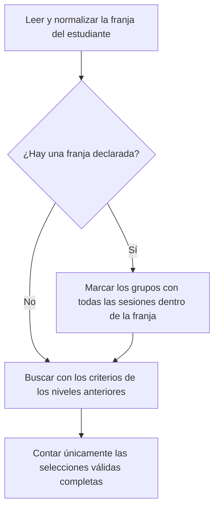

# Franja horaria preferida en el nivel 5

El perfil puede declarar una franja diaria en `estudiante.franja.inicio` y
`estudiante.franja.fin`. Ambos valores deben describir un intervalo dentro
del mismo día con inicio anterior al fin. Se aceptan horas en formato
`HH:mm` o minutos enteros desde medianoche. Omitir la franja o dejarla como
un objeto vacío permite cualquier hora.

## Búsqueda y caso base

Para elegir un grupo, cada sesión debe empezar a la hora inicial de la
franja o después y terminar a la hora final o antes. La comprobación se
aplica a todas las sesiones y todos los días de un grupo.

La búsqueda combina la franja con el filtro de almuerzo antes de elegir cada
grupo. En el caso base se mantienen las reglas de cupos, cruces, prioridades,
créditos y huecos. El grafo completo sigue disponible para las adiciones y
sustituciones del nivel 1.

## Ejemplo

En el [caso de prueba](../../tests/selenium/fixtures/franja.json), el
estudiante elige una franja de 08:00 a 16:00.

| Sesión | Resultado |
| --- | --- |
| 07:59 a 09:00 | Empieza un minuto antes de la franja. |
| 08:00 a 09:00 | Cabe a partir del límite inicial. |
| 15:00 a 16:00 | Cabe hasta el límite final. |
| 15:00 a 16:01 | Termina un minuto después de la franja. |

## Justificación y complejidad

La franja de un grupo depende únicamente de sus sesiones. Una selección que
incluye un grupo fuera de la franja siempre la incumple, por lo que se puede
descartar ese grupo antes de buscar. Los horarios obtenidos son los del
nivel 4 que cumplen la franja, con el filtro aplicado antes del límite de
resultados.

Con `V` grupos elegibles y hasta `M` sesiones por grupo, la comprobación
añade `O(VM)` tiempo. Las marcas de validez se guardan en el mismo arreglo
de `O(V)` espacio que usa el nivel 3. La cota de búsqueda del nivel 4 se
mantiene.

## Aplicación y pruebas

`POST /api/generate` calcula el nivel 5 por defecto y admite los niveles
0 al 4 explícitamente. La interfaz muestra la franja que se aplicó. Antes
de guardar se reconstruyen las sesiones desde el catálogo y se comprueba
el mismo intervalo.

`pnpm test:level-five` prueba ambos extremos, grupos con varias sesiones,
la preferencia opcional y entradas inválidas. También compara el resultado
con el filtrado completo del nivel 4 en 80 catálogos. Las pruebas de API y
Selenium comprueban el flujo de carga, el calendario y el guardado.
