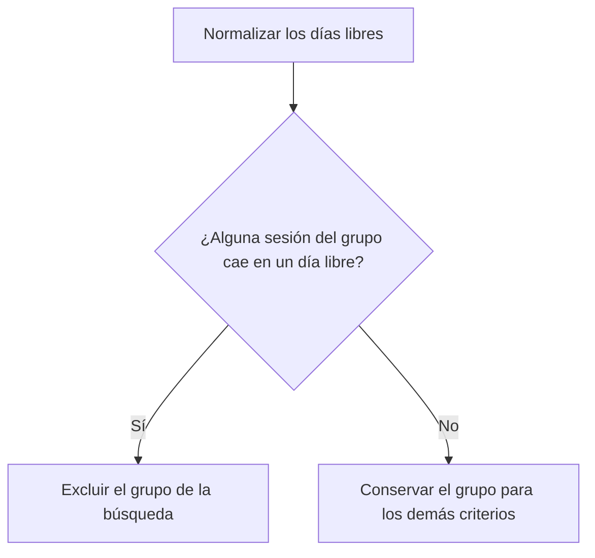

# Días libres en el nivel 6

`estudiante.diasLibres` es una lista opcional de lunes a sábado. Una lista
vacía permite todos los días. Los nombres y códigos de día se normalizan
como para las sesiones, y se rechazan los duplicados tras normalizarlos.

## Búsqueda y caso base

Se guarda el conjunto de días libres y se descarta un grupo si cualquiera
de sus sesiones cae en ese conjunto. El filtro se combina con el almuerzo
y la franja preferida antes de elegir un grupo. El caso base conserva la
validación acumulada y el límite cuenta únicamente horarios válidos.

Por ejemplo, un grupo con sesiones el lunes y el sábado queda excluido si
el sábado es libre. Las comprobaciones de adiciones y sustituciones propias
del nivel 1 siguen consultando el grafo original.

## Justificación y complejidad

El criterio depende de cada sesión del grupo. Una selección que incluya
un grupo excluido sería inválida, así que revisar antes de elegir conserva
las soluciones. Construir el conjunto cuesta `O(D)` para `D` días libres.
El filtro añade `O(VM)` comprobaciones para `V` grupos con hasta `M`
sesiones. Se conserva la búsqueda del nivel 5.

## API y pruebas

`level: 6` ejecuta este nivel. La interfaz muestra los días libres y el
servidor los comprueba de nuevo con el catálogo antes de guardar.
`pnpm test:level-six` cubre días repetidos, grupos con varias sesiones y
preferencias omitidas. `pnpm test:level-six:api` cubre la generación y el
rechazo de una selección con sesiones en un día libre.
