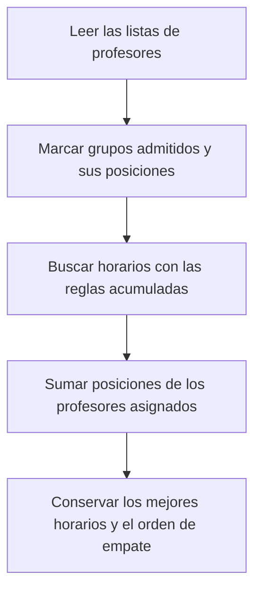

# Profesores preferidos en el nivel 7

Cada materia puede declarar una lista ordenada `profesoresPreferidos`.
Si la lista se omite o está vacía, se admite cualquier docente. Cuando hay
una lista, los grupos elegidos de esa materia deben tener un profesor de
ella. Si el catálogo carece por completo de grupos con esos docentes para
una materia solicitada, se informa que no hay horario para ese perfil.

## Búsqueda y caso base

Se indexan los profesores del catálogo y la posición de cada preferido.
Los grupos se filtran al elegirlos y el grafo del nivel 0 sigue disponible
para evaluar las reglas de prioridad. En cada horario válido se suman las
posiciones, comenzando desde cero. Las materias sin lista aportan cero.
El orden es ascendente y los empates mantienen el orden de búsqueda.

Por ejemplo, en el [catálogo de prueba](../../tests/selenium/fixtures/profesores.json)
la lista es P1 seguida de P2. Los grupos A1 y A3 de P1 aparecen primero,
seguidos de A2 de P2. A0 corresponde a P3 y queda excluido.

## Justificación y complejidad

El filtro depende del profesor de cada grupo. El orden se calcula antes
del límite de salida, así que una opción mejor encontrada más tarde puede
desplazar a otra. Después de comprobar que hay más resultados que el límite,
se pueden podar ramas cuya suma parcial ya iguala o supera la peor
conservada. Las posiciones son no negativas y un empate posterior no
cambia el orden.

El índice de profesores, grupos y preferencias usa espacio lineal en
la entrada. En una hoja válida, insertar en la lista ordenada cuesta
`O(K)` para un límite de `K` horarios. La búsqueda conserva una cota
exponencial en el peor caso.

## API y pruebas

`level: 7` ejecuta este nivel. La selección guardada y las descargas
incluyen el docente cuando figura en el catálogo. El servidor reconstruye
el nombre y la posición al guardar.

`pnpm test:level-seven` comprueba listas neutras, referencias, empates y
orden antes del límite. También compara la búsqueda con un filtrado y
ordenamiento completos en 80 casos.
