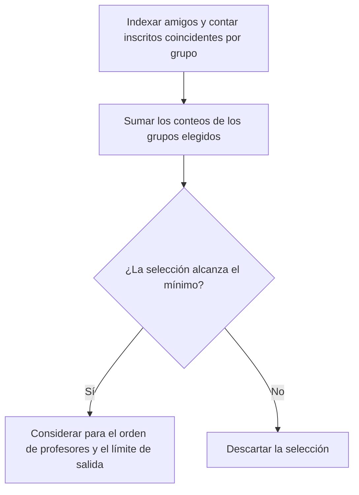

# Coincidencias con amigos en el nivel 8

Una coincidencia es la pareja de un amigo del estudiante y una materia
incluida cuyo grupo tiene a ese amigo en `catalogo.grupos[].inscritos`.
Un amigo en dos materias cuenta dos veces. Dos amigos en una materia
también cuentan dos veces. Varias sesiones del mismo grupo mantienen una
sola coincidencia por amigo y materia.

`estudiante.amigos` identifica a los amigos y el mínimo se declara en
`estudiante.minCoincidenciasAmigos`. Si falta algún campo, la lista está vacía
o el mínimo es cero, el criterio admite cualquier cantidad. Las listas
de amigos e inscritos rechazan identificadores duplicados.

## Búsqueda y caso base

Se indexan los amigos en un conjunto y se calcula por grupo el tamaño de
su intersección con los inscritos. En el caso base de la búsqueda se suman
estos conteos para los grupos elegidos. Se acepta el total igual o superior
al mínimo, manteniendo todos los criterios de los niveles anteriores.

El [caso de prueba](../../tests/selenium/fixtures/amigos.json) tiene dos
amigos de un total de tres inscritos en A2, y uno en B1. A2 y B1 suman tres
coincidencias. Un horario con A1 y B1 suma dos y queda fuera cuando el
mínimo es tres, aunque tenga mejor posición en profesores.

## Justificación y complejidad

Cada materia tiene como máximo un grupo elegido, y los inscritos de cada
grupo son únicos. Por ello, sumar las intersecciones cuenta cada pareja
amigo y materia exactamente una vez. El filtro se aplica antes del límite
y conserva el orden relativo del nivel 7 entre los horarios que lo cumplen.

Con `F` amigos, `V` grupos y `I` inscripciones en total, el
preprocesamiento cuesta `O(F + V + I)` tiempo esperado con conjuntos y
mapas. La suma por selección cuesta un tiempo lineal en sus grupos. La
búsqueda conserva la cota de peor caso del nivel 7.

## API y pruebas

`POST /api/generate` ejecuta el nivel 8 por defecto. El servidor recalcula
las coincidencias al guardar y conserva el total en PostgreSQL. La interfaz
lo muestra cuando corresponde y las exportaciones lo incluyen.

`pnpm test:level-eight` comprueba el conteo, la preferencia neutra, el
mínimo imposible y la conservación del orden en 80 catálogos. Las suites
de API y Selenium cubren generación, validación, exportación y persistencia.
